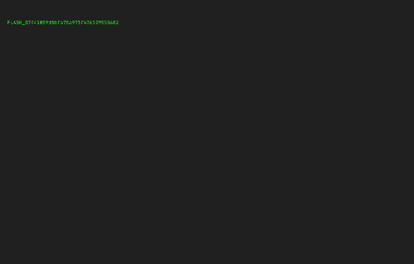

# OSC 555 visual flash

**Both bare OSC 555 forms produced a visible flash in the disposable macOS pane and restored its original pixels.** Disabling `BellVisualEnabled` suppressed both. A standalone BEL with audio disabled provided the positive visual control. VT tests cover the absence of bell, audio-path and other host notifications on OSC 555, including split input. The App coalesces pending visual requests and ignores repeats during an active 90 ms flash.

foot documents a bare OSC 555 terminated by ST as a request to flash the terminal. The pinned terminfo.dev 4.0.0 terminal callback writes home and erase-line, writes the BEL-terminated OSC, then asks for the cursor position. Each run answered `ESC [ 1 ; 1 R`. Replaying the original callback returns **inconclusive** because cursor position cannot establish a visual effect. There is no termless callback. The archived stock verdict is also inconclusive. This batch measures the visual portion of #998. [foot-ctlseqs(7)](https://manpages.debian.org/unstable/foot/foot-ctlseqs.7.en.html)

| Request | Baseline App, visual on | Fixed App, visual on | Fixed App, visual off |
| --- | --- | --- | --- |
| BEL control · `07` | Flash and restoration | Flash and restoration | Steady |
| Pinned OSC · `1b 5d 35 35 35 07` | Inconclusive, 80.2 ms sampling gap | Flash and restoration | Steady |
| foot OSC · `1b 5d 35 35 35 1b 5c` | Steady | Flash and restoration | Steady |

The fixed App's first qualifying samples spanned 17.4–25.7 ms after the pinned write and 15.9–22.9 ms after the foot write. Each changed all 229,200 pixels. Samples beginning 180.9 ms and 175.6 ms after the respective writes matched the original RGBA pixels exactly. All three runs kept the prepared cursor, cell details, resolved colors and complete 256-entry palette through every trial. Each restored the original main screen and kernel PTY settings and released its desktop lease after verified cleanup.

| Before pinned OSC | During flash | Restored |
| --- | --- | --- |
|  |  |  |

The worker wrote a colored nonce on a disposable alternate screen, hid the caret, and parked it at row 1, column 1. Its private PTY fenced each trial with a fresh challenge. The parent sampled the identified 140 × 41 pane with App capture mode `live`, which rasterizes the current TerminalView on the UI thread. The PNGs are 600 × 382 at half scale. Start and end times enclose each RPC on the shared host monotonic clock. These frames measure App presentation. Native compositor timing and physical audio output were outside the observation.

The pixel test requires a change of at least 8 RGB levels in one channel over at least 90% of the pane, followed by exact restoration. A steady verdict requires an unchanged sample within the first 80 ms and a worst-case sampling gap of at most 60 ms through the restoration window. The baseline pinned run captured only steady pixels but missed this timing requirement. The pre-change #1078 parser suite separately reproduced silent consumption for both terminators.

## Evidence and reproduction

All three archives include the original PNG sequence, timed journal, raw CPR and fences, private settings, source snapshot, owner and cleanup proof, desktop lease events and the independently rederived receipt. The manifest pins each archive and records the operator-supplied App source revision. The measured App and executable hashes are in the machine-readable report. [Baseline archive](baseline/owned-run.zip) · [Fixed enabled archive](enabled/owned-run.zip) · [Fixed disabled archive](disabled/owned-run.zip) · [Manifest](manifest.json) · [Report and timings](report.json)

The baseline App revision was `6d16bd84bdac25cd8b51a0fa7a4554d74702401d`, the fixed App revision was `657b67f024eea39e5a20f25ab1a9d8fccc9965db`, and the collector revision was `a0c8318b6eca2b4fb6ea7cd09c30c65a061ef397`. Measurement used macOS 27.0.1 (26A434), arm64, and Node 24.22.2. Run the offline checks from the publication checkout with Node 24 and Python 3.

~~~sh
node scripts/terminfo/osc-flash-publication.mjs --check
node --test scripts/terminfo/osc-flash-publication.test.mjs
~~~

For a fresh measurement, publish each recorded App revision into its own private sidecar directory. Run the collector from the measured scripts revision on an awake macOS desktop. Use the enabled scope with both Apps and the disabled scope with the fixed App. The launcher acquires the shared desktop lock.

~~~sh
scripts/build.sh publish src/Ntilde.App -c Release -r osx-arm64 --self-contained false -p:PublishAot=false -p:PublishTrimmed=false -p:PublishSingleFile=false -p:SkipCliShim=true -o "$SIDECAR"
node scripts/terminfo-owned.mjs --executable "$SIDECAR/Ntilde" --app-version "0.14.0+$APP_REVISION" --scope osc555
node scripts/terminfo-owned.mjs --executable "$FIXED_SIDECAR/Ntilde" --app-version "0.14.0+$FIXED_APP_REVISION" --scope osc555-disabled
~~~

